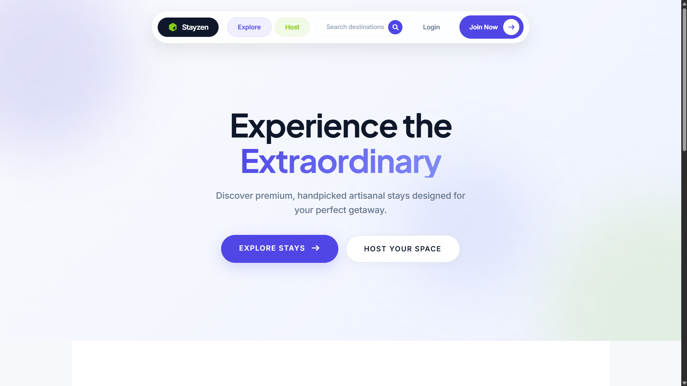
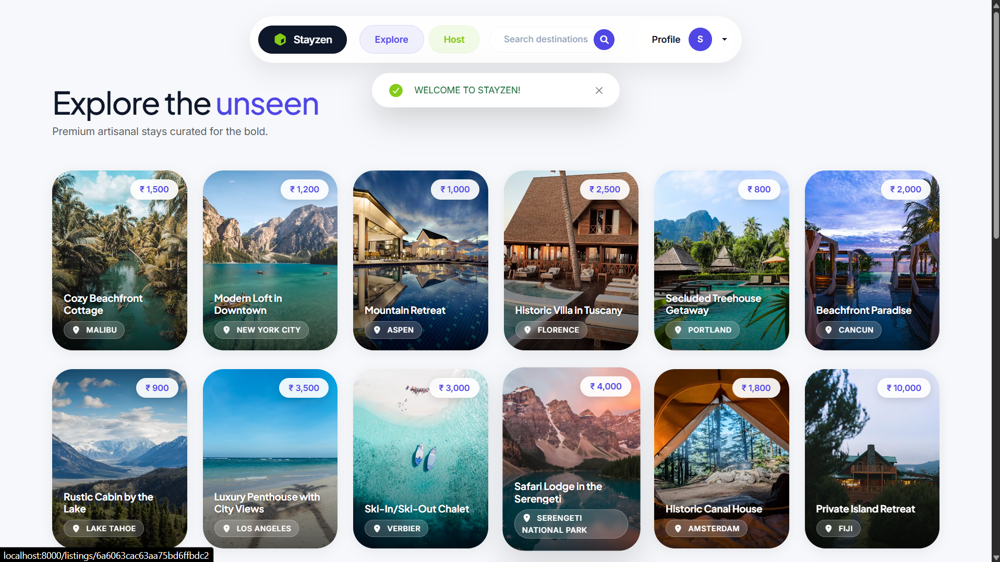
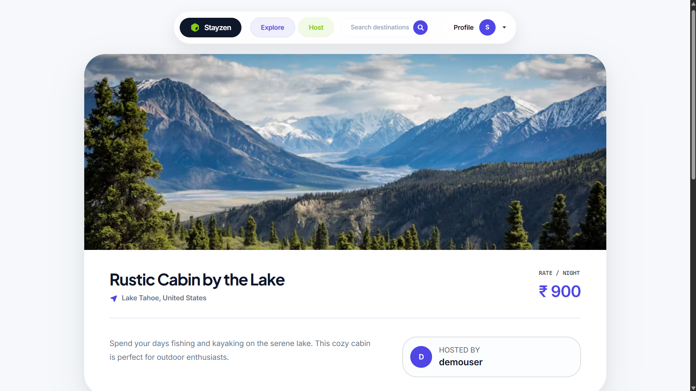
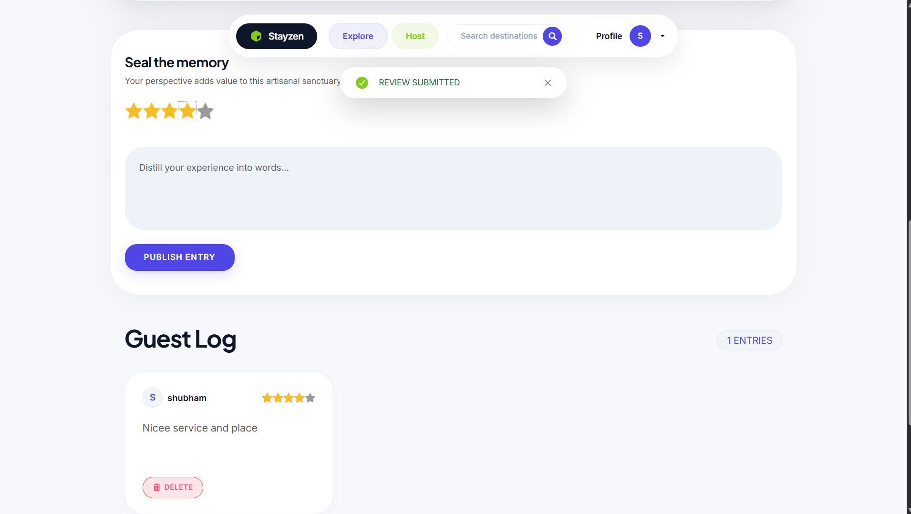
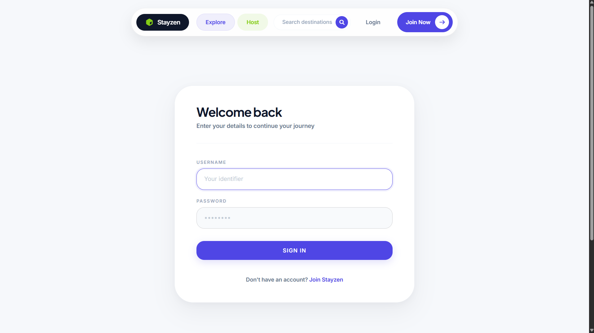
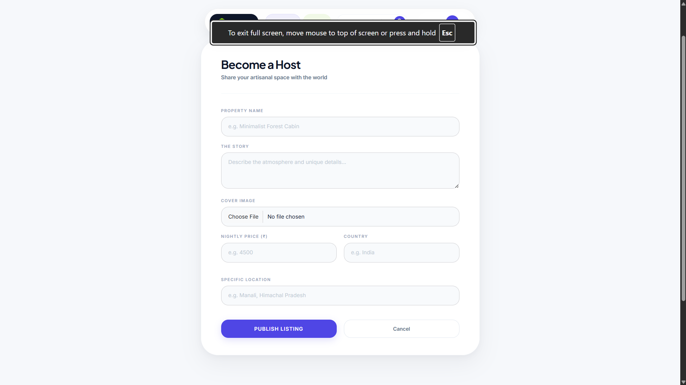

<div align="center">
  
# Stayzen

**An artisanal sanctuary for discovering premium local experiences.**

<br />

</div>

<br />

### Technology Stack

| Domain | Technologies |
| :--- | :--- |
| **Frontend** |     |
| **Backend** |   |
| **Database** |   |
| **Cloud & Auth** |   |

<br />

<br />

## Application Previews

| Home Page | Explore Listings |
| :---: | :---: |
|  |  |

| Listing Details | User Reviews |
| :---: | :---: |
|  |  |

| Authentication | Become a Host |
| :---: | :---: |
|  |  |

<br />

## Table of Contents

- [About The Project](#about-the-project)
- [Architecture](#architecture)
- [Core Features](#core-features)
- [Directory Structure](#directory-structure)
- [Local Setup Instructions](#local-setup-instructions)

<br />

## About The Project

Stayzen is a full-stack web application developed to demonstrate a complete, robust property rental platform. Designed with modern aesthetics and a focus on user experience, this repository serves as a practical implementation of the MVC (Model-View-Controller) architecture using the MERN-adjacent stack (MongoDB, Express, Node.js, and EJS).

**Note:** This repository is intended for learning and demonstration purposes. It showcases how to build production-ready backend systems, implement secure session management, and handle complex relational data in a NoSQL environment.

<br />

## Architecture

Stayzen strictly follows the **MVC (Model-View-Controller)** architectural pattern to ensure separation of concerns, scalability, and maintainability.

* **Models**: Mongoose schemas defining the data structure for Users, Listings, and Reviews. Includes data validation and middleware for cascading deletes (e.g., deleting a listing deletes all associated reviews).
* **Views**: EJS templates layered with `ejs-mate` for reusable layouts and partials. The views inject dynamic server data seamlessly into the frontend.
* **Controllers**: Asynchronous Node.js functions handling business logic, database transactions, and error routing.
* **Middleware**: Custom express middleware for route protection, ownership authorization, file uploading, and error handling.

<br />

## Core Features

* **Authentication & Authorization**: Secure user registration, login, and logout capabilities using Passport.js with Local Strategy. Implements role-based access control protecting specific routes.
* **Property Management**: Authenticated users can create, edit, and delete their own property listings.
* **Interactive Review System**: Users can leave 5-star ratings and written reviews on properties. Includes authorization checks to ensure users can only modify their own reviews.
* **Media Management**: Integration with Cloudinary for seamless, scalable cloud image hosting and transformation.
* **Advanced Search**: Fuzzy search implementation allowing users to dynamically filter destinations based on location.
* **Premium Interface**: Custom CSS paired with Bootstrap 5 and EJS layouts to create a highly polished, artisanal frontend aesthetic.

<br />

## Directory Structure

```text
Stayzen/
├── controllers/       # Business logic for routes
├── init/              # Database seeding scripts and sample data
├── Models/            # Mongoose schemas (User, Listing, Review)
├── public/            # Static assets (CSS, JS, Screenshots)
├── routes/            # Express router definitions
├── utils/             # Helper classes (Error handling, Async wrapping)
├── views/             # EJS templates, layouts, and partials
├── app.js             # Application entry point
├── cloudConfig.js     # Cloudinary configuration
├── middleware.js      # Custom route protection and authorization
└── package.json       # Dependencies and scripts
```

<br />

## Local Setup Instructions

Follow these steps to configure and run the application on your local machine.

### 1. System Requirements

* **Node.js** (v14.0.0 or higher recommended)
* **MongoDB** (Running locally on the default port `27017`)
* A **Cloudinary** Account (The free tier is sufficient for development)

### 2. Repository Setup

Clone the repository and install the required dependencies:

```bash
git clone <your-repository-url>
cd stayzen
npm install
```

### 3. Environment Configuration

Create a `.env` file in the root directory of the project. You will need to obtain your API credentials from your Cloudinary dashboard.

```env
CLOUD_NAME=your_cloudinary_cloud_name
CLOUD_API_KEY=your_cloudinary_api_key
CLOUD_API_SECRET=your_cloudinary_api_secret
```

*Optional: To connect to a cloud database instead of a local instance, add `MONGO_URL=your_mongodb_uri` to the `.env` file.*

### 4. Database Initialization

This project includes a seeding script that wipes existing data and populates the database with sample properties and a demonstration user account.

```bash
node init/index.js
```

Running this script will automatically generate a host account that you can use to test authenticated features.
* **Username:** `demouser`
* **Password:** `demopassword`

### 5. Running the Server

Start the application using the following command:

```bash
node app.js
```

For development with hot-reloading, use nodemon:

```bash
npx nodemon app.js
```

The server will initialize and listen on **`http://localhost:8000`**. Open this address in your browser to explore Stayzen.
